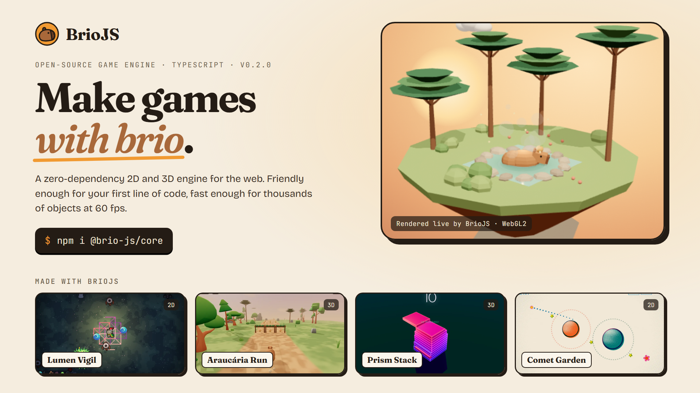

<p align="center">
    <a href="https://playground.briojs.gregorium.com/">
        
    </a>
</p>

<h1 align="center">BrioJS</h1>

<p align="center">
    <strong>A zero-dependency 2D and 3D web game engine written in TypeScript.</strong>
</p>

<p align="center">
    <a href="https://www.npmjs.com/package/@brio-js/core"></a>
    <a href="https://github.com/glgreg/brio-js/actions/workflows/ci.yml"></a>
    <a href="./LICENSE.txt"></a>
</p>

<p align="center">
    <a href="https://playground.briojs.gregorium.com/"><strong>Website</strong></a> ·
    <a href="https://playground.briojs.gregorium.com/playground"><strong>Playground</strong></a> ·
    <a href="https://playground.briojs.gregorium.com/#games"><strong>Demo games</strong></a> ·
    <a href="#documentation"><strong>Docs</strong></a> ·
    <a href="./CHANGELOG.md"><strong>Changelog</strong></a>
</p>

---

BrioJS gives you an approachable, object-oriented API (`BrioGame`, `BrioScene`, `BrioObject2D`, `BrioObject3D`) on
top of a data-oriented Entity-Component-System core, so a first game reads like a script while the engine keeps its
state in contiguous typed arrays.

It is built for learning and fast prototyping: it sits between visual tools such as Scratch or GDevelop and
heavyweight engines such as Unity or Unreal.

## Table of contents

- [Highlights](#highlights)
- [Try it in the browser](#try-it-in-the-browser)
- [Installation](#installation)
- [Quick start](#quick-start)
- [Examples](#examples)
- [Core concepts](#core-concepts)
- [Status](#status)
- [Documentation](#documentation)
- [Contributing](#contributing)
- [License](#license)

## Highlights

| Feature | Details |
| --- | --- |
| **2D and 3D in one engine** | Sprites, layers, and split-screen cameras next to meshes, materials, lights, and glTF models. |
| **GPU rendering with a fallback** | WebGL2 by default, with a Canvas2D software rasterizer when the GPU path is unavailable. |
| **Batteries included** | Scenes, text, tile maps (Tiled import), collision events, action-based input (keyboard, mouse, touch, gamepad), Web Audio, and storage. |
| **Save states built in** | Checkpoints and restarts restore the whole game state, and a seeded random generator makes runs reproducible. |
| **Sharp on every screen** | Renders at the device pixel ratio and can fit the window while game code stays in logical pixels. |
| **No dependencies** | Tree-shakeable named exports; the 3D backends and model loaders load on demand. |

## Try it in the browser

The [BrioJS website](https://playground.briojs.gregorium.com/) has a **playground**: an in-browser IDE with the full
type definitions, drag and drop assets, a console, and zip export. Projects stay in your own browser, with no account
and nothing to install.

<p>
    <a href="https://playground.briojs.gregorium.com/playground?template=hello-brio"><strong>▶ Open the playground</strong></a>
</p>

Four demo games show what the engine can do. Each one is a normal BrioJS project and opens in the playground with its
full source:

| Game | Look | Play | Source |
| --- | --- | --- | --- |
| **Lumen Vigil** | 2D pixel art drawn as lit GPU quads | [Play](https://playground.briojs.gregorium.com/play?game=lumen-vigil) | [Open in playground](https://playground.briojs.gregorium.com/playground?template=lumen-vigil) |
| **Araucária Run** | 3D low-poly glTF runner with shadows and fog | [Play](https://playground.briojs.gregorium.com/play?game=araucaria-run) | [Open in playground](https://playground.briojs.gregorium.com/playground?template=araucaria-run) |
| **Prism Stack** | 3D neon glass stacker with PBR and point lights | [Play](https://playground.briojs.gregorium.com/play?game=prism-stack) | [Open in playground](https://playground.briojs.gregorium.com/playground?template=prism-stack) |
| **Comet Garden** | 2D risograph-style gravity puzzle | [Play](https://playground.briojs.gregorium.com/play?game=comet-garden) | [Open in playground](https://playground.briojs.gregorium.com/playground?template=comet-garden) |

The website source lives in [`showcase/`](./showcase/README.md).

## Installation

```bash
npm install @brio-js/core
```

BrioJS is published as ES modules with TypeScript declarations. It runs in modern browsers (Chrome, Edge, Firefox,
Safari) and works with any bundler (Vite, esbuild, webpack, Rollup) or directly through a `<script type="module">`:

```html
<script type="module">
    import { BrioGame } from "https://cdn.jsdelivr.net/npm/@brio-js/core@0.2/dist/index.js";
</script>
```

## Quick start

Every game follows the same lifecycle: `preload()` loads assets, `load()` builds the world once, and `update()`
changes it every frame.

### A 2D game

```html
<div id="game"></div>
<script type="module" src="./main.js"></script>
```

```js
// main.js
import { BrioGame, BrioSprite, BrioObject2D, BrioText, BrioLayer, BrioCollision } from "@brio-js/core";

const game = new BrioGame({ width: 640, height: 360, container: document.getElementById("game") });
game.useKeyboard();
game.input.bind("left", "ArrowLeft", "a").bind("right", "ArrowRight", "d");

let coins = 0;
const score = new BrioText("txt_score", "Coins: 0", { size: 20, strokeWidth: 3 });

game.preload(() => [new BrioSprite("spr_player", "./player.png"), new BrioSprite("spr_coin", "./coin.png")])
    .load(() => {
        const hud = new BrioLayer({ name: "hud", order: 100, policy: "ui" });
        hud.addObject(score);

        const player = new BrioObject2D("obj_player", "spr_player");
        const coin = new BrioObject2D("obj_coin", "spr_coin");
        coin.tag = "coin";
        coin.transform.position = { x: 300, y: 0 };
        for (const object of [player, coin]) {
            BrioCollision.addRectangle({ object, colliderType: "trigger", pos: { x: 0, y: 0 }, size: { x: 32, y: 32 } });
        }
        player.onCollisionEnter((other) => {
            if (other.tag !== "coin") return;
            score.text = `Coins: ${++coins}`;
            game.destroy(other);
        });
        return [hud, score, player, coin];
    })
    .update((updater, dt) => {
        const player = updater.getObject("obj_player");
        player.transform.position.x += game.input.axis("left", "right") * 200 * dt;
    });
```

### A 3D scene

```js
import { BrioGame, BrioMesh, BrioMaterial, BrioObject3D, BrioCamera3D, BrioLight } from "@brio-js/core";

const game = new BrioGame({
    width: 800,
    height: 450,
    container: document.getElementById("game"),
    dimension: "3d",
});

game.preload(() => [BrioMesh.createBox("mesh_box"), new BrioMaterial("mat_orange", { color: "#f97316" })])
    .load(() => [
        new BrioCamera3D("cam", { position: { x: 3, y: 3, z: 5 }, clearColor: "#0b1220" }),
        new BrioLight("sun", "directional", { direction: { x: -1, y: -2, z: -1 }, intensity: 2 }),
        new BrioLight("sky", "hemisphere", { color: "#9cc3ff", groundColor: "#2b2118", intensity: 0.6 }),
        new BrioObject3D("obj_box", "mesh_box", "mat_orange"),
    ])
    .update((updater, dt) => {
        game.gameObjects3D.get("obj_box").transform.rotation.y += dt;
    });
```

## Examples

The [`examples/`](./examples/README.md) folder has four complete, runnable projects with no binary assets:

| Example | Dimension | What it shows |
| --- | --- | --- |
| **Star Catcher** | 2D | Title and play scenes, a text HUD, collision events, an input map with gamepad support, camera shake, fixed-step simulation, sound, and a saved best score. |
| **Tile Platformer** | 2D | A Tiled map drawn in chunks, tile colliders, coins spawned from a prefab, checkpoints, and a camera that follows the player, fitted to the window. |
| **Orbit Gallery** | 3D | Procedural meshes, lights, an orbit camera, and mouse picking; add `?backend=canvas2d` to see the fallback renderer. |
| **Lantern Courtyard** | 3D | Physically based materials, point and spot lights, shadows, fog, tone mapping, and a water pool written as a custom GLSL shader. |

To run them locally:

```bash
git clone https://github.com/glgreg/brio-js.git && cd brio-js
npm install && npm run build
node e2e/serve.mjs 8080   # zero-dependency static server; then open http://localhost:8080/examples/2d-star-catcher/
```

## Core concepts

<details open>
<summary><strong>Game structure</strong></summary>

| Concept | What it does |
| --- | --- |
| **Lifecycle** | `preload()` loads assets asynchronously, `load()` creates the initial content, and `update()` runs every frame. `fixedUpdate()` runs simulation at a fixed rate (`fixedTimestep`, with optional render `interpolate`). |
| **Presets** | `dimension: "2d"` (no 3D memory), `"3d"`, or `"hybrid"` (2D layers composed over 3D passes). |
| **Scenes** | `new BrioScene(name).preload(...).load(...)`, then `game.addScene()` / `game.setScene()`. `scene.restart()` returns to the state right after `load()`. |
| **Assets** | `game.onLoadProgress()` drives loading bars; `game.unloadAsset()` and `game.removeScene()` free memory, scenes keep only what another owner still uses. |

</details>

<details open>
<summary><strong>Gameplay</strong></summary>

| Concept | What it does |
| --- | --- |
| **Text** | `BrioText` draws text (font, size, color, alignment, wrapping, outline, shadow) as a regular 2D object, in the world or on a `"ui"` layer. |
| **Collisions** | Colliders (`BrioCollision.addRectangle` / `addCircle`) raise `onCollisionEnter` / `onCollisionStay` / `onCollisionExit` once per frame; `BrioCollision.resolveCollision()` separates solid objects. |
| **Input** | `game.input` maps actions to keys, mouse buttons, gamepad buttons and sticks, and touch; bindings can be changed and saved at runtime. |
| **Tile maps** | `BrioTileMap` (hand-made grids, CSV or Tiled JSON) renders from a `BrioSpriteSheet` in cached chunks and builds merged colliders. |
| **Audio** | `BrioAudio` plays through `BrioAudioMixer` buses (`master`, `bgm`, `sfx`) and unlocks on the first click or key press. |

</details>

<details open>
<summary><strong>Rendering</strong></summary>

| Concept | What it does |
| --- | --- |
| **Screen** | `pixelRatio` keeps the game sharp on high-DPI screens; `game.useFullScreen("fit")` scales a fixed logical resolution to the window. |
| **Layers and cameras** | `BrioLayer` planes (`static` cached, `parallax`, `dynamic` culled, `ui` in screen space); one pass per `BrioCamera2D` / `BrioCamera3D` viewport for split-screen and minimaps. |
| **Rendering backends** | The cascade picks WebGL2 when available and moves to the next backend if one fails to initialize, ending with the Canvas2D rasterizer. |
| **Lights** | `BrioLight` (`directional`, `ambient`, `hemisphere`) per game or scene; without lights a default sky-and-sun rig is used. |
| **Models** | `BrioModel` loads GLB, glTF, and OBJ/MTL with textures; names are namespaced as `"<model>/<name>"`. |

</details>

<details open>
<summary><strong>State and determinism</strong></summary>

| Concept | What it does |
| --- | --- |
| **Save states** | `game.createCheckPoint()` / `restoreCheckPoint()` / `restart()` restore every object (transforms, sprites, colliders, text, hierarchy, tile maps), the active scene, and `game.random`; binary snapshots (`BrioSerializer`, format v3) stay readable across versions. |
| **Determinism** | `game.random` is a seeded `BrioRandom` (`seed` option); `game.step(dt)` advances frames manually for tests and tools. |

</details>

Every public class, method, and property is documented with TSDoc, so editors show usage examples inline. Generate the
API reference with `npm run doc`.

## Status

BrioJS is at **v0.2**, a preview for simple 2D and 3D games: the API is usable but may still change between minor
versions (see the breaking changes in [`CHANGELOG.md`](./CHANGELOG.md)).

| Area | Status |
| --- | --- |
| ECS core, pooling, generational handles, binary snapshots | Stable |
| Scenes, fixed timestep, seeded randomness | Stable |
| 2D layers, multi-viewport cameras, sprites, animations, 2D collisions and collision events | Stable |
| WebGL2 3D renderer and Canvas2D fallback | Stable, with per-object frustum culling and context-loss recovery (tested in browsers) |
| Text, tile maps (Tiled JSON / CSV), input map, high-DPI and fit-to-window | New in v0.2 |
| Lights | Directional, ambient, and hemisphere in v0.2; point/spot lights, PBR, and shadows are on `develop` for the next release (see [`CHANGELOG.md`](./CHANGELOG.md)) |
| glTF / GLB / OBJ | Static meshes and textures; skinning and animation are planned |
| Web Audio | Buses and autoplay unlock; positional audio is planned |
| WebGPU backend | Planned for v0.3 |
| UI widgets, particles, tweens | Planned |

Known issues and the roadmap are tracked in [`docs/ROADMAP.md`](./docs/ROADMAP.md); release notes are in
[`CHANGELOG.md`](./CHANGELOG.md).

## Documentation

**Guides and references**

- [Roadmap and known issues](./docs/ROADMAP.md)
- [Domain glossary](./GLOSSARY.md): the engine's ubiquitous language.
- [Examples](./examples/README.md) and the [website and playground](./showcase/README.md).

**Architecture**

- [Target architecture](./docs/architecture/TARGET_ARCHITECTURE.md): ECS backend, multi-backend renderer, layers, and workers.
- [Rendering study](./docs/architecture/RENDERING_STUDY_THREEJS.md): techniques studied from three.js and the WebGPU plan.
- [MCP game authoring](./docs/architecture/MCP_GAME_AUTHORING.md): the proposed MCP server for agentic game creation.

**Architecture decision records**

| ADR | Decision |
| --- | --- |
| [0001](./docs/adr/0001-zero-dependency-multi-backend-renderer.md) | Zero-dependency multi-backend renderer |
| [0002](./docs/adr/0002-oop-facade-over-soa-ecs.md) | OOP facade over a SoA ECS |
| [0003](./docs/adr/0003-multi-canvas-layers-and-offscreen-workers.md) | Multi-canvas layers and offscreen workers |
| [0004](./docs/adr/0004-concrete-2d-3d-domain-and-strict-ubiquitous-language.md) | Concrete 2D/3D domain and strict ubiquitous language |
| [0005](./docs/adr/0005-binary-ecs-state-serialization.md) | Binary ECS state serialization |
| [0006](./docs/adr/0006-mcp-agentic-game-authoring.md) | MCP agentic game authoring (proposed) |
| [0007](./docs/adr/0007-third-party-code-policy.md) | Third-party code policy |

## Contributing

```bash
npm install
npm run check      # type check, tests (Vitest), and build, the same as CI
npm run test:e2e   # the examples in a real browser (Playwright, Chromium)
npm run test:watch
```

Issues and pull requests are welcome at [github.com/glgreg/brio-js](https://github.com/glgreg/brio-js/issues); see
[`CONTRIBUTING.md`](./CONTRIBUTING.md) for the setup, branch and commit conventions. The detailed engineering
checklist is [`TODO.md`](./TODO.md).

## License

[MIT](./LICENSE.txt) © Gustavo L. Gregorio. Third-party notices are in
[`THIRD_PARTY_NOTICES.md`](./THIRD_PARTY_NOTICES.md).
