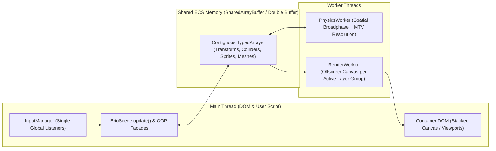

# BrioJS Target Architecture (Technical Specification v1.0)

This document specifies the target architecture of BrioJS on the `refactor` branch, consolidating every design and domain modeling decision.

> **Status note (2026-10-28)**: this is a target specification, not a description of the current code. Several names and components differ from what is implemented today: the backends are `RenderBackend`, `WebGL2Backend` and `Canvas2DBackend` (no `WebGPU`/`WebGL1` backend yet), there is a single main-thread canvas with offscreen caches for `"static"` layers, and there is no `RenderWorker` or `PhysicsWorker`. See the "Implementation status" sections of ADR-0001 to ADR-0005 in `docs/adr/` for the current state.

---

## 1. Guiding Architectural Principles

1. **Pedagogical Bridge with Industrial Power**: a simple and intuitive public surface (OOP + modular tooling functions) backed by a data-oriented internal core (SoA ECS in `TypedArrays`, multi-threading and GPU batching).
2. **Zero-Dependency**: no external runtime dependency in `package.json`. The whole 2D, 3D, math, physics, audio and serialization pipeline is native to the engine.
3. **Strict Ubiquitous Language**: aliases are allowed **exclusively** for complexity abstractions (e.g. the `"2d"` and `"3d"` presets at initialization), and purely semantic aliases are **forbidden** (e.g. there is only `trigger`, never `intangible`; there is only `BrioAtlas`, never `BrioSpriteAtlas`; there are concrete classes `BrioObject2D` and `BrioObject3D`).
4. **Agent Context Optimization (ACO) & Complete Documentation**: 100% of classes, methods, functions, interfaces, types and properties must have rigorous JSDoc/TSDoc with a clear description, `@param`, `@returns` and `@example`, supporting both human learning and accurate code generation by LLMs.
5. **Tree-Shaking & Strict Modularity**: utility functions and 2D/3D subsystems are exported independently, without top-level side effects (`"sideEffects": false`).
6. **Cross-Platform Portability**: consistent execution in web browsers, desktop (Electron), mobile (Capacitor) and headless test environments through capability detection (_feature detection_) and progressive fallbacks.

---

## 2. Proposed Directory Topology (`./src/`)

```text
src/
├── index.ts                      # Main entry point (tree-shakeable named exports)
├── core/
│   ├── BrioGame.ts               # Central orchestrator, "2d"|"3d" presets and BrioGameConfig
│   ├── BrioScene.ts              # Lifecycle (preload -> load -> update), cameras and layers
│   ├── BrioLayer.ts              # Composition layers (static, parallax, dynamic, ui)
│   ├── BrioViewport.ts           # Normalized screen regions (full-screen, split-screen, PiP)
│   └── BrioTimer.ts              # Schedulers (wait, loop, tween) driven by the scene deltaTime
├── ecs/
│   ├── ECSWorld.ts               # EntityId registry, bitmasks, archetypes/pools and O(1) object pool
│   ├── ComponentStorage.ts       # SoA storage in TypedArrays (SharedArrayBuffer / ArrayBuffer)
│   └── systems/                  # Internal systems (TransformSystem, PhysicsSystem, RenderSystem)
├── objects/
│   ├── BrioObject2D.ts           # Concrete 2D class (OOP facade over an ECS EntityId)
│   ├── BrioObject3D.ts           # Concrete 3D class (OOP facade over an ECS EntityId)
│   ├── BrioTransform2D.ts        # Reactive 2D transform with local/world hierarchy support
│   └── BrioTransform3D.ts        # Reactive 3D transform (Vec3, Quat/Euler, Mat4, local/world)
├── rendering/
│   ├── BrioRenderer.ts           # Selector and facade of the graphics pipeline
│   ├── contracts/
│   │   └── RenderBackend.ts      # Deterministic contract shared by every graphics API
│   ├── backends/
│   │   ├── WebGPURenderer.ts     # Priority 1: WebGPU (2D batching & 3D pipeline)
│   │   ├── WebGL2Renderer.ts     # Priority 2: WebGL2 (instanced arrays & UBOs)
│   │   ├── WebGL1Renderer.ts     # Priority 3: WebGL1 (universal GPU fallback)
│   │   └── Canvas2DRenderer.ts   # Priority 4: Canvas2D + software 3D projector fallback
│   └── workers/
│       ├── RenderWorker.ts       # Rendering in an OffscreenCanvas off the main thread
│       └── LayerCompositor.ts    # Management of multiple canvases / framebuffers
├── assets/
│   ├── BrioAssetManager.ts       # Central manager and asynchronous loaders
│   ├── BrioTexture.ts            # Decoded raw resource (ImageBitmap/GPUTexture) + TextureRegistry
│   ├── BrioAtlas.ts              # Mapping of arbitrary sub-regions and BrioSprite factory
│   ├── BrioSpriteSheet.ts        # BrioSprite and BrioAnimation factory based on a uniform grid
│   ├── BrioSprite.ts             # Public 2D visual unit
│   ├── BrioAnimation.ts          # Time-based frame sequences (keyframes)
│   ├── BrioTileMap.ts            # 2D grid maps (matrices / Tiled / LDtk) with collider merging
│   ├── BrioMesh.ts               # 3D geometry (Box, Sphere, Plane, custom vertices/OBJ/glTF)
│   ├── BrioMaterial.ts           # 3D surface definition (color, texture, shading)
│   └── BrioAudio.ts              # Hybrid Web Audio API engine (GainNodes, AudioBuffer) + HTMLAudio fallback
├── cameras/
│   ├── BrioCamera2D.ts           # Orthographic 2D camera (follow, lerp, deadzone, bounds, shake, culling)
│   └── BrioCamera3D.ts           # 3D camera (perspective/orthographic, fov, near/far, lookAt, frustum)
├── physics/
│   ├── BrioCollision.ts          # 2D (AABB, Circle) and 3D (Box3D, Sphere3D) detection + MTV resolution
│   ├── BrioRigidBody.ts          # Optional physics profile (velocity, gravity, friction, restitution)
│   ├── SpatialHash2D.ts          # 2D broad phase to avoid O(N^2) complexity
│   ├── SpatialOctree3D.ts        # 3D broad phase
│   └── PhysicsWorker.ts          # Physics simulation decoupled in a Web Worker
├── input/
│   ├── InputManager.ts           # Single global listener per device on the main thread
│   ├── BrioKeyboard.ts           # Per-instance keyboard state + global static methods
│   ├── BrioMouse.ts              # Position (screen/world), buttons, wheel and picking
│   ├── BrioTouch.ts              # Multi-touch support for mobile web and Capacitor
│   └── BrioGamepad.ts            # Gamepad API polling with deadzones and vibration
├── storage/
│   ├── BrioSerializer.ts         # Pure binary ECS snapshots (ArrayBuffer) + optional JSON translator
│   └── BrioStorage.ts            # Cross-platform persistence (state, session, local, db/IndexedDB)
├── math/
│   ├── BrioMath.ts               # Scalar math functions (clamp, lerp, degToRad, radToDeg)
│   ├── vec2.ts                   # Pure tree-shakeable functions + reactive atomic BrioVec2 class
│   ├── vec3.ts                   # Pure tree-shakeable functions + reactive atomic BrioVec3 class
│   ├── quat.ts                   # Quaternions for 3D rotation without gimbal lock
│   └── mat4.ts                   # 4x4 matrices for 3D transformation and projection
├── debugging/
│   ├── BrioDebugger.ts           # Zero-allocation visual debug and console configuration
│   ├── BrioConsole.ts            # Logger with stack trace filtering (user vs internal)
│   └── game_logs.ts              # Typed catalog of errors and exceptions
└── tools/
    ├── base_types.ts             # Template literal types (CSS, keys, anchors, colors)
    └── PlatformAdapter.ts        # Environment abstraction (Browser, Electron, Capacitor, Headless)
```

---

## 3. Detailed Subsystem Specification

### 3.1. `BrioGame` Entry Point and `"2d"` / `"3d"` Presets

`BrioGame` remains the central entry class of the engine, accepting either a simplified configuration through a preset (`"2d"` or `"3d"`) or a full `BrioGameConfig` object:

```ts
export type GameDimensionPreset = "2d" | "3d";

export interface BrioGameConfig {
    dimension: GameDimensionPreset;
    width: number;
    height: number;
    container: HTMLElement;
    preferredBackend?: "webgpu" | "webgl2" | "webgl1" | "canvas2d" | "auto";
    useOffscreenWorkers?: boolean;
    maxEntities?: number;
    pixelArt?: boolean;
}
```

- When the user initializes `new BrioGame(640, 480, container, "2d")` (or omits the preset, which defaults to `"2d"`), the engine automatically applies the ideal settings for 2D.
- When it is initialized with `"3d"` or a detailed `BrioGameConfig`, the corresponding pipeline is allocated on demand.
- `BrioGame` instantiates an implicit `defaultScene: BrioScene` so that beginners can chain `game.preload(...).load(...).update(...)` directly, while intermediate/advanced users can register multiple scenes with `game.addScene(scene)` and switch between them with `game.setScene("level_1")`.

### 3.2. Multi-Backend Graphics Pipeline (`WebGPU -> WebGL2 -> WebGL1 -> Canvas2D`)

Every backend implements the strict `RenderBackend` interface:

- **`init(surface: HTMLCanvasElement | OffscreenCanvas): Promise<boolean>`**
- **`beginFrame(viewport: ViewportRect, clearColor?: Color): void`**
- **`flushLayer2D(layerData: LayerRenderBuffer2D, cameraMatrix: Float32Array): void`**
- **`flushLayer3D(layerData: LayerRenderBuffer3D, viewProjMatrix: Float32Array): void`**
- **`endFrame(): void`**
- **`dispose(): void`**

Automatic selection chain (`preferredBackend: "auto"`):

1. **WebGPU (`WebGPURenderer`)**: uses `GPURenderPipeline` and storage/uniform buffers fed directly by the ECS `Float32Array`s.
2. **WebGL2 (`WebGL2Renderer`)**: uses `drawArraysInstanced` / `drawElementsInstanced` and Vertex Array Objects (VAOs) to draw thousands of 2D sprites or 3D meshes in a few draw calls.
3. **WebGL1 (`WebGL1Renderer`)**: uses dynamic vertex batching in an `ARRAY_BUFFER` for compatibility with old GPUs.
4. **Canvas2D (`Canvas2DRenderer`)**: universal fallback. In 2D mode, it uses `CanvasRenderingContext2D` (`OffscreenCanvasRenderingContext2D` when in a Worker). In 3D mode, it enables a built-in **software 3D projector** that projects the 3D mesh vertices through the `ViewProjection` matrix and draws the polygons sorted by depth (_Painter's Algorithm_).

### 3.3. Multi-Canvas Compositor (`BrioLayer`), Multi-Viewport (Split-Screen) and `OffscreenCanvas` Workers

To serve everything from 2D games with multiple parallax layers and complex UI (e.g. dialogue boxes overlaid on the game and a HUD above the dialogue boxes, _Persona_ style) to games with split-screen local multiplayer (_Gears of War 3_ style):



1. **Layer Policies (`BrioLayer`)**:
    - `static`: has its own dedicated buffer/canvas. It renders only once at `load` or when an entity on that layer is mutated (_dirty flag_). Zero cost per frame.
    - `parallax`: has a scroll factor `scrollFactor: Vec2` relative to the active camera.
    - `dynamic`: redraws every frame, following the ECS transforms.
    - `ui`: operates in screen coordinates (_screen space_) and accepts arbitrary stacking (`order: number`), allowing independent sub-layers (e.g. `ui-world-indicators` -> `ui-dialogue-box` -> `ui-dialogue-portrait` -> `ui-top-hud` -> `ui-modal-pause`).
2. **Multiple Viewports (`BrioViewport`)**:
    - A `BrioScene` supports multiple simultaneously active cameras (`scene.cameras`).
    - Each camera has a `viewport: { x: number, y: number, width: number, height: number }` normalized between `0` and `1` (default `{ x: 0, y: 0, width: 1, height: 1 }`).
    - For 2-player split-screen (horizontal or vertical) or 4 players, it is enough to instantiate 2 or 4 cameras pointing at different targets with their respective viewport rectangles; `BrioRenderer` applies `scissor` / `viewport` clipping for each camera in the same frame.
3. **Thread Synchronization (`SharedArrayBuffer` -> `Transferable` -> `MainThread`)**:
    - The main thread processes only DOM events (input) and the user's high-level logic.
    - The `RenderWorker` takes control of the `<canvas>` elements via `transferControlToOffscreen()`.
    - The `PhysicsWorker` runs the broad phase and collision resolution over the ECS `TypedArrays`.

### 3.4. Public OOP API Bridge vs. Internal ECS Core (SoA)

- Every `BrioObject2D` or `BrioObject3D` instantiated by the user receives an `entityId: number` allocated by `ECSWorld`.
- Transform, velocity, collision and rendering data live in pre-allocated typed arrays (`Float32Array`, `Uint32Array`, `Uint8Array`) inside `ComponentStorage`.
- The vector properties exposed in the public API (`transform.position`, `transform.scale`, `transform.size`, `transform.pivot`, `transform.skew`) are `BrioVec2` / `BrioVec3` instances bound to the entity's index in the `Float32Array`.
- When the user writes `player.transform.scale.x = -2`, the `x` setter of `BrioVec2` writes directly into the ECS `Float32Array`, updates the flip flag and sets the entity's `DIRTY_TRANSFORM` bit, without allocating any object in memory.
- **Transparent Object Pooling**: `scene.instantiate(prefab)` reuses the IDs of entities previously destroyed via `scene.destroy(entity)` in $O(1)$ time using an internal _free list_, copying only the prefab's row of bytes into the component arrays.

### 3.5. Physics, Collisions (`solid` vs. `trigger`) and Broad Phase

- **Ubiquitous Language**: the collision mode is strictly `"solid"` or `"trigger"`.
- **Physical Resolution (`"solid"`)**: computes the symmetric _Minimum Translation Vector_ (MTV) for `rectangle`, `square`, `circle` (2D) and `box`, `sphere` (3D), automatically separating solid objects and adjusting the velocity if they have a `BrioRigidBody`.
- **Event Detection (`"trigger"`)**: applies no separation force; it fires `onTriggerEnter`, `onTriggerStay`, `onTriggerExit` callbacks or returns `true` from the direct query `BrioCollision.isOverlapping(a, b)`.
- **Broad Phase**: a `SpatialHash2D` (in 2D) and a `SpatialOctree3D` (in 3D) automatically partition space on every physics step, reducing the collision tests to pairs in the same spatial cell.

### 3.6. Pure Binary Serialization (`BrioSerializer`) and `BrioStorage`

- Because all mutable scene state lives in the `ECSWorld` `TypedArrays`, `BrioSerializer.captureSnapshot(scene)` produces a compact `Uint8Array` / `ArrayBuffer` with a binary header (magic bytes, version, active entity count, component offset table) and a direct memory copy (`TypedArray.set`).
- `scene.createCheckpoint()` and `scene.restart()` restore the `ArrayBuffer` directly into the ECS pools in under 1 millisecond, without involving `JSON.stringify` or `JSON.parse`.
- An optional translation layer (`BrioSerializer.toJSON(snapshot)` and `BrioSerializer.fromJSON(json)`) converts the binary buffer into readable JSON only when the developer wants to export/inspect external files.
